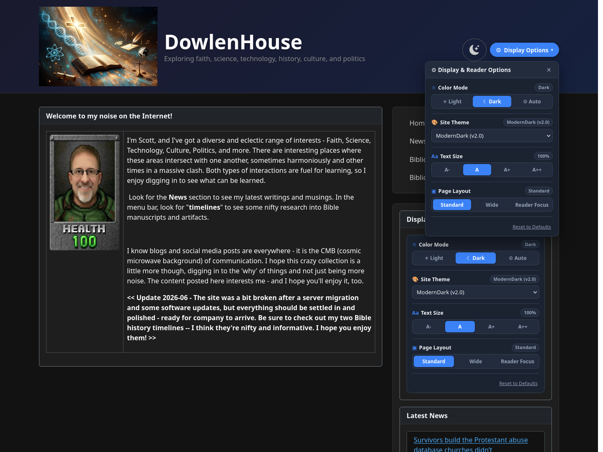
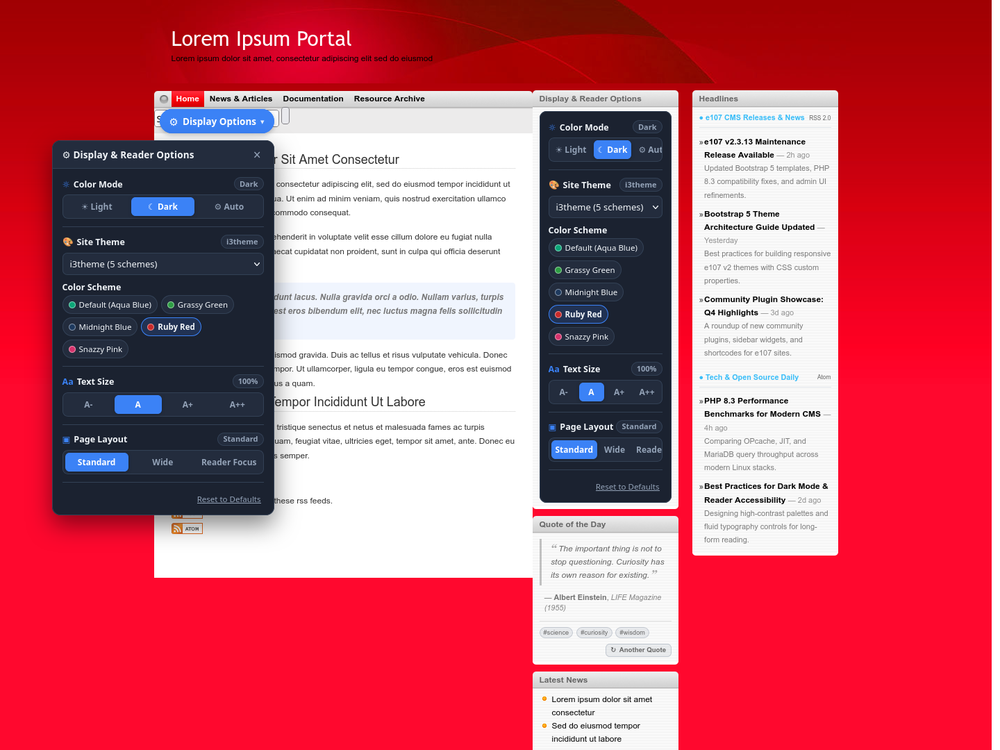
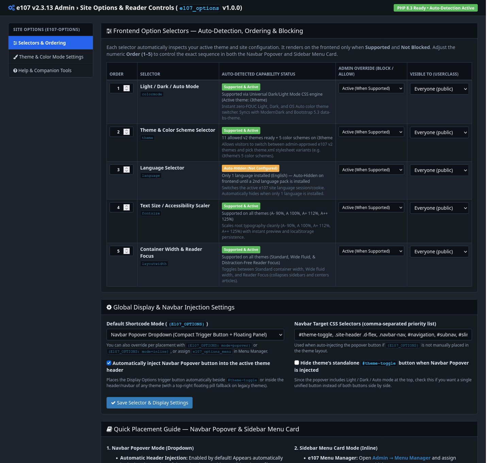
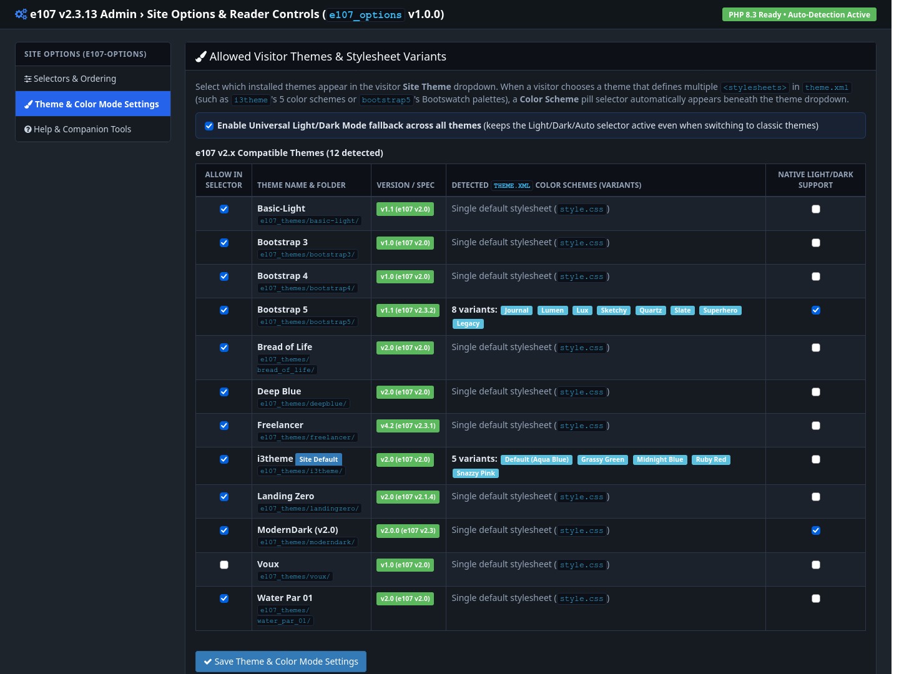

# e107 Display Options (`e107_options`) v1.0.1

A unified, zero-FOUC **Display & Reader Options** plugin for **e107 v2.3+** (compatible with **PHP 7.4 through PHP 8.4+** and **Bootstrap 3, 4, and 5** themes).

Provides visitors with an accessible, persistent control panel — available as both a **Navbar Popover** (`{E107_OPTIONS}` / `{E107_OPTIONS_NAV}`) and a **Sidebar Menu** (`e107_options_menu`) — for customizing their reading and browsing experience without page-load flash (FOUC).

> *Imagined by human, built with AI.*

---

## Key Features

- **5 Integrated Display & Reader Selectors** (individually orderable, collapsible, or restrictable by e107 userclass):
  1. **Color Mode (`light` / `dark` / `auto`)** — Supports native Bootstrap 5 / `data-bs-theme` dark mode AND includes a **Universal Dark/Light Mode CSS Engine** that brings dark/light switching to classic Bootstrap 3/4 and legacy v2 themes.
  2. **Frontend Theme Switcher** — Automatically discovers installed e107 v2 frontend themes (or restricts to an admin-curated list) so visitors can preview or switch themes on the fly without altering the site default for other visitors.
  3. **Theme Color Variant / Palette Switcher** — Automatically detects sub-palettes/stylesheets inside the active theme (such as `i3theme` color schemes or custom theme variants).
  4. **Language Switcher** — Integrates with e107 multi-language support when multiple languages are installed.
  5. **Reader Typography & Layout Width Controls** — Adjustable text size (`90%` – `125%`) and comfortable reading container width.
- **Zero-FOUC Early Head Injection (`e_header.php`)** — Applies saved visitor preferences (`localStorage` + cookie sync) in `<head>` before first paint.
- **Automatic Capability Detection & Force-Blocking** — Automatically hides selectors that don't apply to the current site/theme (e.g., single-language site or theme without variants), with admin overrides.

---

## Screenshots

### Frontend Navbar Popover & Sidebar Widget (`moderndark` / Bootstrap 5)


### Theme Variant Auto-Detection (`i3theme` Sub-Palettes)


### Admin Configuration — Selectors, Ordering & Status


### Admin Configuration — Allowed Themes & Color Mode Engine


---

## Installation

> **Important Note on Plugin Folder Name (`e107_options`):**
> - **Recommended:** Download **`e107_options_v1.0.1.zip`** from the [Releases page](https://github.com/scottdd/e107-display-options/releases/latest). It is pre-packaged with the required **`e107_options/`** folder structure.
> - **If you use GitHub's green "Code → Download ZIP" button (`e107-display-options-main.zip`) or `git clone`:** You **must** rename the extracted folder inside `e107_plugins/` to **`e107_options`** (or `e107_display_options` — **never use hyphens** like `e107-display-options`). e107 v2's `e107_handlers/shortcode_handler.php` constructs the PHP shortcode class name directly from the folder name (`<folder>_shortcodes`), and PHP class names cannot contain hyphens (`-`).

### Option A: One-Click Upload via e107 Admin (Recommended)
1. Download **`e107_options_v1.0.1.zip`** from the [latest GitHub Release](https://github.com/scottdd/e107-display-options/releases/latest).
2. In your e107 Admin area, go to **Admin → Plugin Manager → Upload Plugin** and upload `e107_options_v1.0.1.zip`.
3. Click **Install** next to **e107 display options** (`e107_options`).

### Option B: Clone or Extract into `e107_plugins/`
```bash
cd /path/to/e107/e107_plugins
git clone https://github.com/scottdd/e107-display-options.git e107_options
```
Then visit **Admin → Plugin Manager** and install **e107 display options**.

---

## Placement & Shortcodes

- **Sidebar / Menu Manager:** Enable `e107_options_menu` in **Admin → Menu Manager** to display the collapsible card in any theme menu area.
- **Navbar Popover Trigger:** Add `{E107_OPTIONS}` (or `{E107_OPTIONS_NAV}`) to your theme's navbar/header template, or leave automatic navbar injection enabled in **Admin → e107 Display Options**.

---

## Changelog

### v1.0.1 (2026-10-26)
- **Relative Path Resolution (`#1`):** Replaced all hardcoded `e_PLUGIN . 'e107_options/...'` file includes and asset/preference lookups with `__DIR__`-relative paths and `e107_options_manager::getPluginFolder()`, so the plugin works cleanly even if installed under an underscore-renamed folder such as `e107_display_options/`.
- **Shortcode Handler & PHP 8.2–8.4+ Compatibility (`#1`):** Added dynamic `class_alias('e107_options_shortcodes', '<folder>_shortcodes')` in `e_shortcode.php` and added `{E107_OPTIONS_NAV}` alongside `{E107_OPTIONS}`.
- **Menu Manager & Language Fallback Hardening (`#1`):** Added automatic `English_front.php` / `English_admin.php` fallback when a non-English site language pack does not yet include plugin translation files, preventing any `500` error when rendering `e107_options_menu`.

### v1.0.0 (2026-10-25)
- Initial public release.

---

## Compatibility & License

- **e107 CMS:** v2.3.0+
- **PHP:** 7.4, 8.0, 8.1, 8.2, 8.3, 8.4+
- **Frontend Frameworks:** Bootstrap 3, Bootstrap 4, Bootstrap 5, and custom e107 v2 themes
- **License:** [GPL-2.0-or-later](LICENSE)

---

*Imagined by human, built with AI.*
